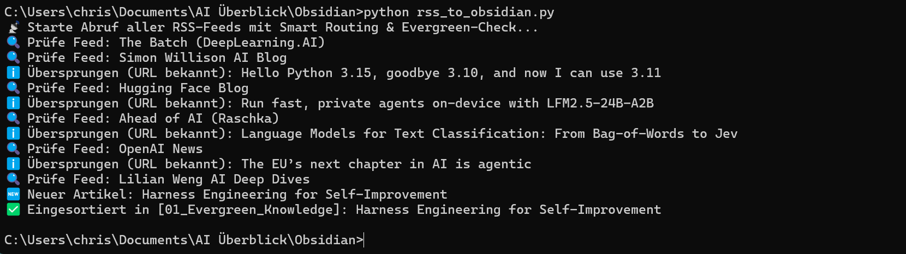
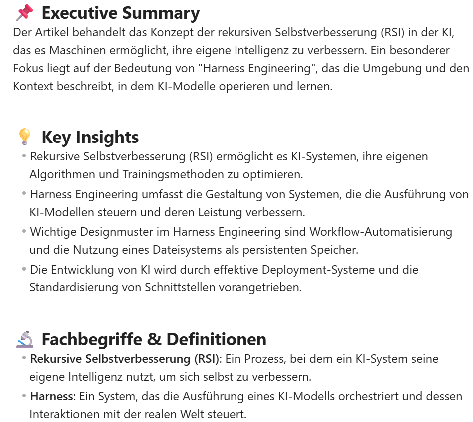

# 📡 AI Knowledge & Intelligence Radar (Autonomes Second Brain in Obsidian)

> **Ein vollautonomes, produktionsreifes Knowledge-Management-System in Obsidian zur automatisierten Erfassung, intelligenten Aufbereitung und strukturierten Ablage von KI-Wissen aus RSS-Feeds und Telegram.**

---

## 🚀 Executive Summary & Projektziel

Das Ziel dieses Projekts war die Entwicklung eines vollautonomen, produktionsreifen Knowledge-Management-Systems direkt in Obsidian. Statt sich in der täglichen Informationsflut von KI-News zu verlieren, sollte ein zentraler, intelligenter „Ingest-Hub“ entstehen. Dieser sammelt Rohdaten aus handverlesenen RSS-Feeds, Telegram-Chats und PDFs, extrahiert die Volltexte, lässt sie durch `GPT-4o-mini` aufbereiten, sortiert sie intelligent vor (Smart Routing) und schützt das System aktiv vor Redundanzen. Der Fokus liegt dabei auf einer verständlichen, praxisorientierten Wissensbasis, die Einsteigern und angehenden Profis hilft, den technologischen Wandel strukturiert zu durchdringen.

---

## 🛠️ Der Tech-Stack

Das System setzt auf einen schlanken, performanten und vollständig lokal kontrollierten Python-Stack:
- **Programmiersprache:** Python (für Automatisierungs- und Parsing-Skripte)
- **Web Scraping & Extraction:** `trafilatura` (zuverlässige Extraktion sauberer Artikel-Volltexte aus URLs unter Umgehung von Boilerplate)
- **Dokumenten-Ingestion:** `pypdf` (lokales Parsen von PDFs und Whitepapern)
- **Künstliche Intelligenz:** OpenAI `GPT-4o-mini` (für semantische Synthese, Executive Summaries, Key Insights und Klassifizierung)
- **Schnittstellen & Benachrichtigungen:** Telegram Bot API (für mobile Ingestion und Echtzeit-Statusmeldungen)
- **Wissensbasis & Struktur:** Obsidian (lokales Markdown-basiertes Second Brain mit automatisiertem Frontmatter-Management)

---

## 🏗️ Architektur & Datenfluss (Von A bis Z)

Die Pipeline arbeitet im Hintergrund und folgt einem modularen 4-Schichten-Modell:

### Schritt A: Multi-Channel Ingestion Hub
* **RSS-Feeds:** Sechs handverlesene, ausgewogene Top-Quellen decken sowohl aktuelle Branchen-News als auch tiefe technische Deep-Dives ab (*The Batch*, *Simon Willison*, *Hugging Face*, *Ahead of AI*, *OpenAI News*, *Lilian Weng*).
* **Telegram-Listener:** Ein permanent im Hintergrund laufender Bot (`telegram_listener.py`) nimmt geteilte Links oder Dokumente mobil entgegen und füttert das System.

[cite: 10]

### Schritt B: Globaler Duplikats-Schutz (Der Türsteher)
Ein zentrales `processed_links.json`-Register speichert jede erfolgreich verarbeitete URL. Dies verhindert Endlosschleifen und sorgt dafür, dass Artikel niemals doppelt eingelesen werden.

### Schritt C: KI-Synthese & Smart Routing (Das Gehirn)
`GPT-4o-mini` analysiert den Volltext und generiert eine strukturierte Markdown-Notiz mit folgenden Sektionen:
1. Prägnanter deutscher Titel
2. 📌 **Executive Summary** (Zusammenfassung in 2-3 Sätzen)[cite: 11]
3. 💡 **Key Insights** (Die wichtigsten Kernpunkte als Bullet Points)[cite: 11]
4. 🔬 **Fachbegriffe & Definitionen** (Verständliche Erklärungen für Einsteiger)[cite: 11]

[cite: 11]

**Smart Routing:** Die KI klassifiziert den Inhalt am Ende des Prompts automatisch in zwei Kategorien:
* `KATEGORIE: NEWS` $\rightarrow$ Zielordner: `KI_Knowledge_Base/02_News_Events`
* `KATEGORIE: EVERGREEN` $\rightarrow$ Zielordner: `KI_Knowledge_Base/01_Evergreen_Knowledge`

### Schritt D: Evergreen-Deduplizierung & Ablage
Handelt es sich um einen Evergreen-Artikel, prüft ein maßgeschneiderter String-Ähnlichkeits-Abgleich (via Python `difflib`), ob im entsprechenden Ordner bereits eine thematisch identische Notiz existiert (Schwellenwert-Prüfung). Bei einem Treffer wird die Erstellung abgefangen, um Redundanzen im Wissensnetz zu verhindern. Andernfalls wird die Datei mit sauberem YAML-Frontmatter im Zielverzeichnis gespeichert.

[cite: 9]

---

## 🚨 Key Challenges & Lösungen

* **Herausforderung 1: Informationsüberflutung & Fachchinesisch**
  * *Lösung:* Ein speziell optimierter System-Prompt, der technische Fachartikel so aufbereitet, dass Kernkonzepte auch für Einsteiger greifbar und direkt anwendbar werden.
* **Herausforderung 2: Unstrukturierte Inboxes & Vermischung von News und Konzepten**
  * *Lösung:* Implementierung des Smart Routings. Flüchtige Release-Meldungen landen getrennt von zeitlosem Grundlagenwissen in dedizierten Ordnern.
* **Herausforderung 3: Redundante Wissensartikel im Second Brain**
  * *Lösung:* Ein automatisierter Titel- und Inhaltsabgleich vor dem Speichern von Evergreen-Notizen, der das System langfristig schlank, übersichtlich und frei von Dubletten hält.

---

## 🚀 Fazit & Ausblick

Das Projekt beweist, wie sich moderne LLM-APIs, Web-Scraping und lokale Dateisysteme (Obsidian) zu einem mächtigen, autarken Werkzeug verbinden lassen. Das System läuft vollautomatisch im Hintergrund und liefert täglich präzise aufbereitetes, redundanzfreies Wissen – die perfekte Basis für kontinuierliches Lernen im AI-Sektor.

---

## 📂 Repository-Struktur

```text
├── 🐍 rss_to_obsidian.py          # Haupt-Pipeline für RSS-Ingestion & Smart Routing[cite: 10]
├── 🐍 telegram_listener.py        # Hintergrund-Bot für mobile Link-Erfassung
├── 📄 processed_links.json        # Zentrales Register zur Duplikatsvermeidung
├── 📁 00_Inbox/                   # Temporärer Eingangskanal
├── 📁 01_Evergreen_Knowledge/     # Zeitlose Grundlagen & Deep Dives
├── 📁 02_News_Events/             # Aktuelle Branchen-Meldungen & Releases
├── 🖼️ rss-script-execution-log.png  # Terminal-Ausführungsprotokoll[cite: 10]
├── 🖼️ obsidian-generated-note-preview.png # Generierte Markdown-Struktur[cite: 11]
└── 🖼️ obsidian-vault-structure.png        # Vault-Ordner- & Notizansicht[cite: 9]
