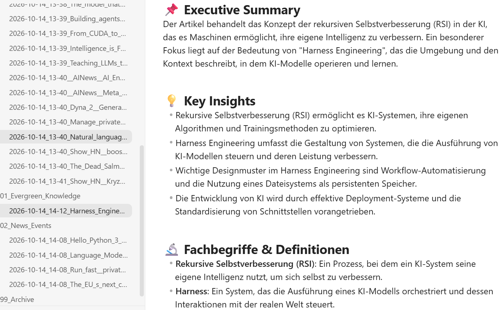

# 🧬 AI Knowledge Radar: KI-News automatisch ins Obsidian-Second-Brain

Eine Python-Pipeline, die Artikel aus RSS-Feeds sowie per Telegram geteilte Links und PDFs einliest, per LLM zusammenfasst, nach News und Grundlagenwissen sortiert und als Notiz in Obsidian ablegt.

---

## Rolle & Entwicklungsansatz

* **Rolle:** Christoph Bauer, Business Analyst: Anforderungen, Datenfluss, Sortierlogik (News vs. Grundlagen), Dublettenvermeidung, Prompt-Design und Test.
* **Umsetzung:** Den Python-Code habe ich mit KI-Coding-Assistenten erstellt und anschließend getestet und angepasst.

*Setup:* API-Schlüssel, Telegram-Daten und lokale Pfade sind im Code durch Platzhalter ersetzt (`"----"` bzw. `./Obsidian_Vault_Example`). Die Verlaufsdatei `processed_links.json` ist im Repository leer.

---

## Ziel

Statt täglich viele KI-News selbst zu sichten, sollen ausgewählte Quellen automatisch gesammelt, verständlich zusammengefasst und geordnet in der eigenen Wissensbasis landen, ohne doppelte Einträge.

---

## Tech Stack

* **Sprache:** Python
* **Volltext aus Webseiten:** `trafilatura`
* **PDFs:** `pypdf`
* **LLM:** OpenAI `gpt-4o-mini` (Zusammenfassung, Kernaussagen, Begriffserklärungen, Einordnung)
* **Mobile Eingabe & Statusmeldungen:** Telegram Bot API
* **Wissensbasis:** Obsidian (Markdown mit YAML-Frontmatter)

---

## Ablauf

### Schritt A: Eingänge
* **RSS-Feeds:** Sechs ausgewählte Quellen mit News und technischen Fachartikeln (*The Batch, Simon Willison, Hugging Face, Ahead of AI, OpenAI News, Lilian Weng*).
* **Telegram-Bot:** `telegram_listener.py` läuft im Hintergrund und nimmt geteilte Links oder PDFs vom Handy entgegen.


### Schritt B: Bereits verarbeitete Links überspringen
`processed_links.json` speichert jede verarbeitete URL, damit kein Artikel doppelt eingelesen wird.

### Schritt C: Zusammenfassung und Einordnung per LLM
`gpt-4o-mini` erstellt aus dem Volltext eine Notiz mit:
1. deutschem Titel
2. 📌 **Zusammenfassung** in 2–3 Sätzen
3. 💡 **Kernaussagen** als Stichpunkte
4. 🔬 **Fachbegriffe** mit kurzen Erklärungen

Zusätzlich ordnet das LLM den Inhalt einer Kategorie zu:
* `KATEGORIE: NEWS` → Ordner `KI_Knowledge_Base/02_News_Events`
* `KATEGORIE: EVERGREEN` → Ordner `KI_Knowledge_Base/01_Evergreen_Knowledge`

### Schritt D: Ähnliche Grundlagen-Notizen vermeiden
Vor dem Speichern einer Grundlagen-Notiz prüft ein Textvergleich (`difflib`) mit Schwellenwert, ob es im Ordner schon eine sehr ähnliche Notiz gibt. In diesem Fall wird keine neue Notiz angelegt.



---

## Herausforderungen und Lösungen

* **Viel Fachsprache:** Der Prompt ist so formuliert, dass auch Einsteiger die Kernideen verstehen.
* **News und Grundlagen vermischt:** Die automatische Einordnung trennt kurzlebige Meldungen von dauerhaft relevantem Wissen.
* **Doppelte Inhalte:** URL-Verlauf und Ähnlichkeitsprüfung halten die Wissensbasis übersichtlich.


---

## Fazit

Das Projekt verbindet LLM-API, Web-Extraktion und lokale Markdown-Ablage zu einem Werkzeug für das eigene Lernen. Die Pipeline läuft im Hintergrund und liefert regelmäßig aufbereitete Notizen.

**Mögliche Erweiterungen:** Tests für Sortierung und Dublettenprüfung, Konfiguration über eine `.env`-Datei.

---

## Repository-Struktur

```text
├── Scripts/
│   ├── rss_to_obsidian.py          # RSS-Pipeline mit Sortierung und Ablage
│   └── telegram_listener.py        # Telegram-Bot für Links und PDFs
├── Pictures/
│   ├── rss-script-execution-log.png
│   ├── obsidian-vault-structure.png
│   └── obsidian-generated-note-preview.png
├── processed_links.json            # Verlauf verarbeiteter Links (leer)
├── requirements.txt
└── README.md
```
